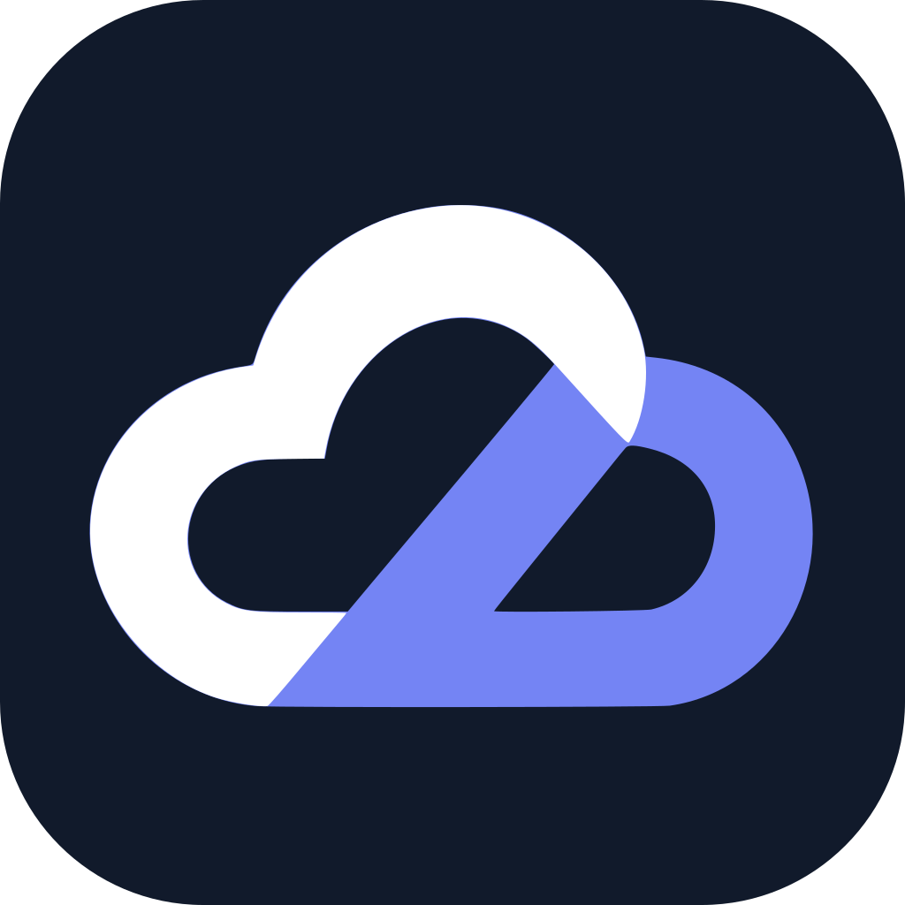
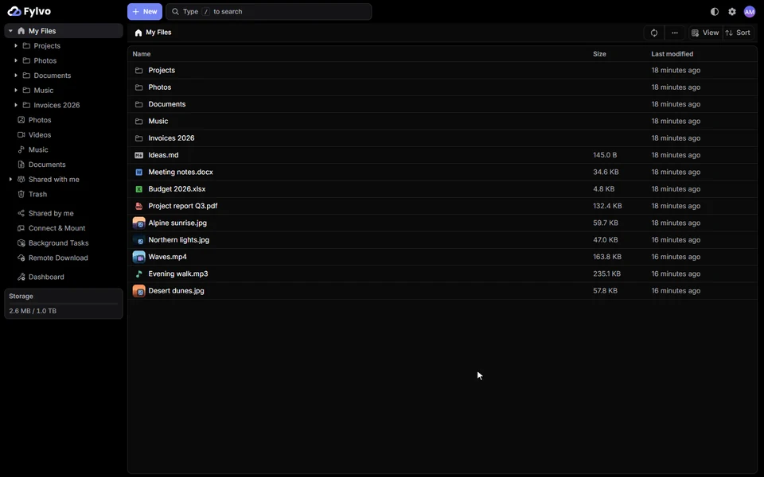
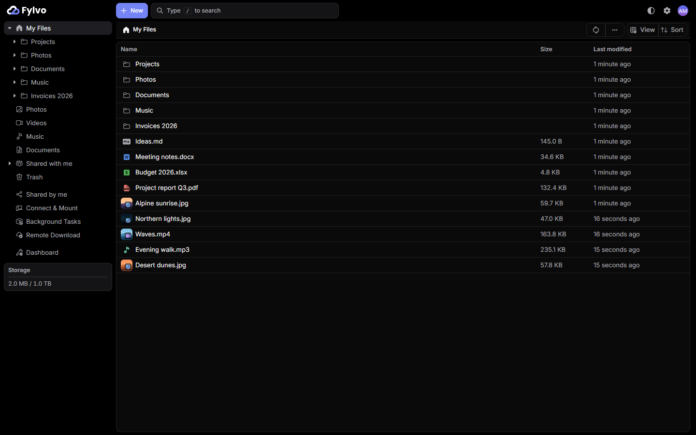
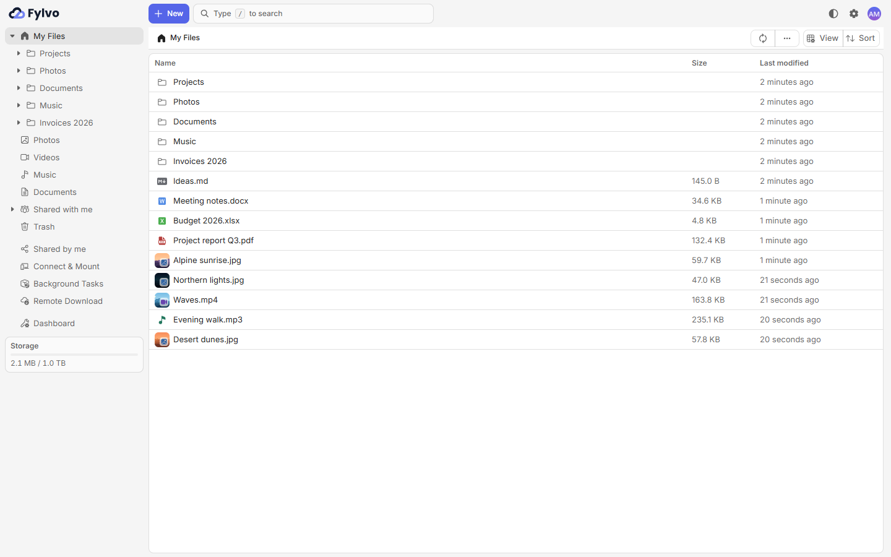
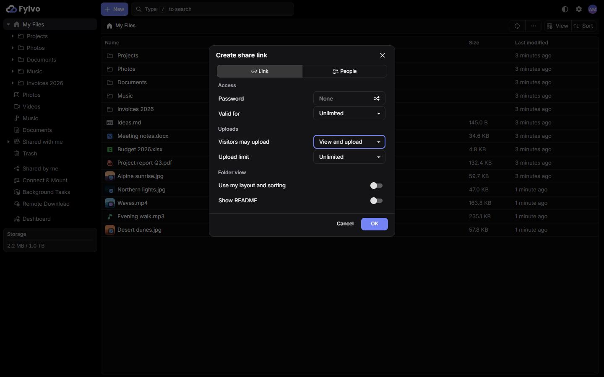
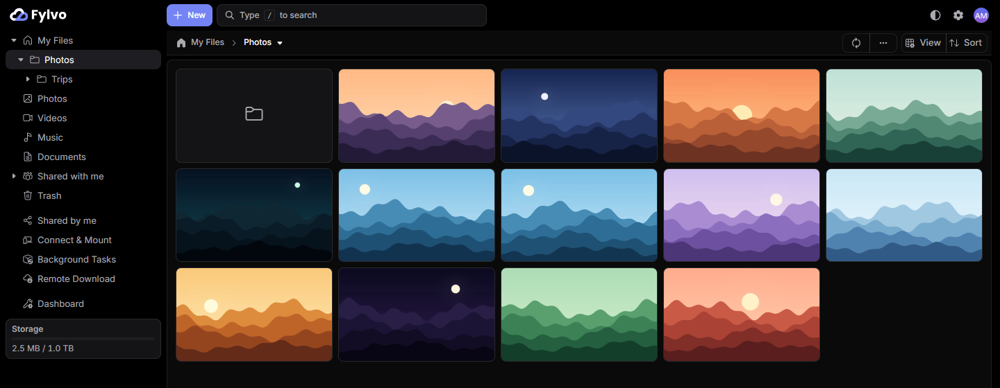
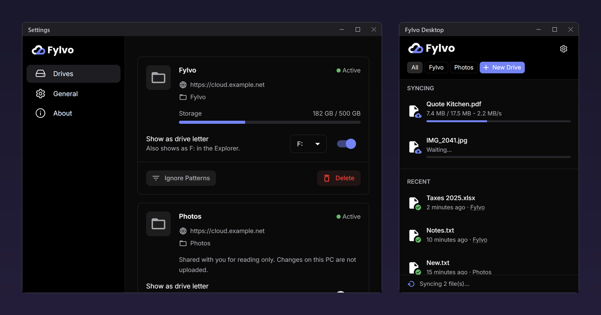

<p align="center">
  
</p>

<h1 align="center">Fylvo</h1>

<p align="center">
  <b>Your files. Your cloud.</b><br>
  A lean, private cloud for your own server: files, sharing, office and sync apps, in one container.
</p>

<p align="center">
  <a href="#quick-start">Quick start</a> ·
  <a href="docs/self-hosting.md">Self-hosting guide</a> ·
  <a href="#apps">Apps</a> ·
  <a href="https://github.com/svenbuild/fylvo/releases">Releases</a>
</p>

<p align="center">
  
</p>

## Why Fylvo

- **Small.** One container with a built-in database. Under 200 MB of memory under load in our tests, no PHP, no separate database server.
- **Private.** Nothing calls home. Registration closes after the first account, wrong passwords lock an address out for a while, passwords are stored with bcrypt.
- **Complete.** Web app, office in the browser, WebDAV, and apps for Android, Windows and Linux.

## Features

| | |
| --- | --- |
| **Files** | Upload large files with resume, folders, search, tags, trash, version history |
| **Previews** | Photos (also RAW and HEIC), videos, music, PDF, text and code, e-books |
| **Sharing** | Links with password, expiry and download limit; upload links that let others add files without an account |
| **Shared folders** | Share a folder with people on your server, per person "read" or "edit" |
| **Office** | Edit Word, Excel and PowerPoint files in the browser with Collabora Online (optional) |
| **Sync** | Windows app with files on demand in the Explorer and an optional drive letter; Linux app; WebDAV for everything else |
| **Phone** | Android app with offline files, offline editing and folder sync |
| **Security** | Two-factor login and passkeys, admin panel for users, groups and storage |

<p align="center">
  
  
</p>
<p align="center">
  
  
</p>

## Quick start

You need a Linux machine with [Docker](https://docs.docker.com/engine/install/).

```bash
mkdir fylvo && cd fylvo
curl -fsSLO https://raw.githubusercontent.com/svenbuild/fylvo/main/docker-compose.yml
docker compose up -d
```

Open `http://<your server>:5212` and create an account. The first account becomes the admin; after it, registration is closed.

Next steps, in this order, are in the **[self-hosting guide](docs/self-hosting.md)**:

1. [Run it behind a reverse proxy with https](docs/self-hosting.md#1-https-with-a-reverse-proxy)
2. [Office in the browser](docs/self-hosting.md#2-office-in-the-browser) (optional)
3. [Backup and restore](docs/self-hosting.md#3-backup-and-restore)
4. [Update](docs/self-hosting.md#4-update)
5. [Connect the apps](docs/self-hosting.md#5-connect-the-apps)

## Apps

<p align="center">
  
</p>

| App | Get it | Notes |
| --- | --- | --- |
| Android | `Fylvo-Android-<version>.apk` from the [releases](https://github.com/svenbuild/fylvo/releases) | Android 9 or newer, not in the Play Store |
| Windows | `Fylvo-Desktop-<version>-windows-x64.zip` from the releases | Windows 10 1903 or newer, signed package |
| Linux | AppImage, `.deb` and `.rpm` from the releases | Preview |

All apps connect to any Fylvo server: you type its address when you sign in. Your server can offer app updates to them, see [the guide](docs/self-hosting.md#5-connect-the-apps).

## Building from source

See [CONTRIBUTING.md](CONTRIBUTING.md).

## Status

Fylvo is a hobby project, used every day by its maintainer. Issues and ideas are welcome, there are no promises on when or whether they are handled. Security problems: see [SECURITY.md](SECURITY.md).

## License

GPL-3.0, see [LICENSE](LICENSE). Fylvo is based on [Cloudreve](https://github.com/cloudreve/cloudreve); see [NOTICE](NOTICE) for the origin of its parts.
